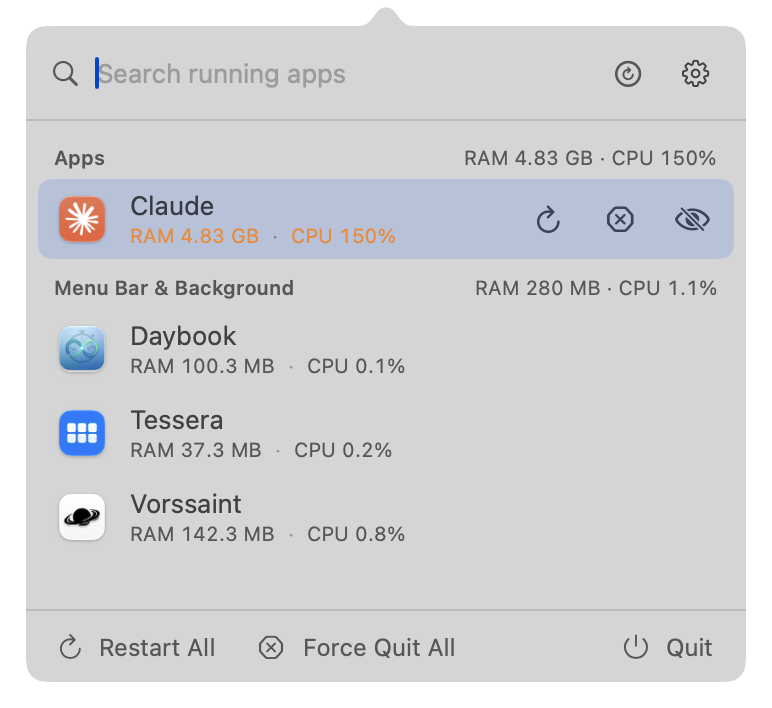
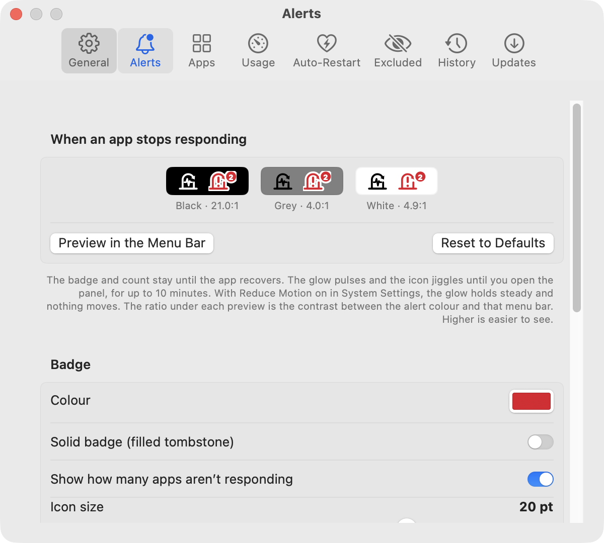
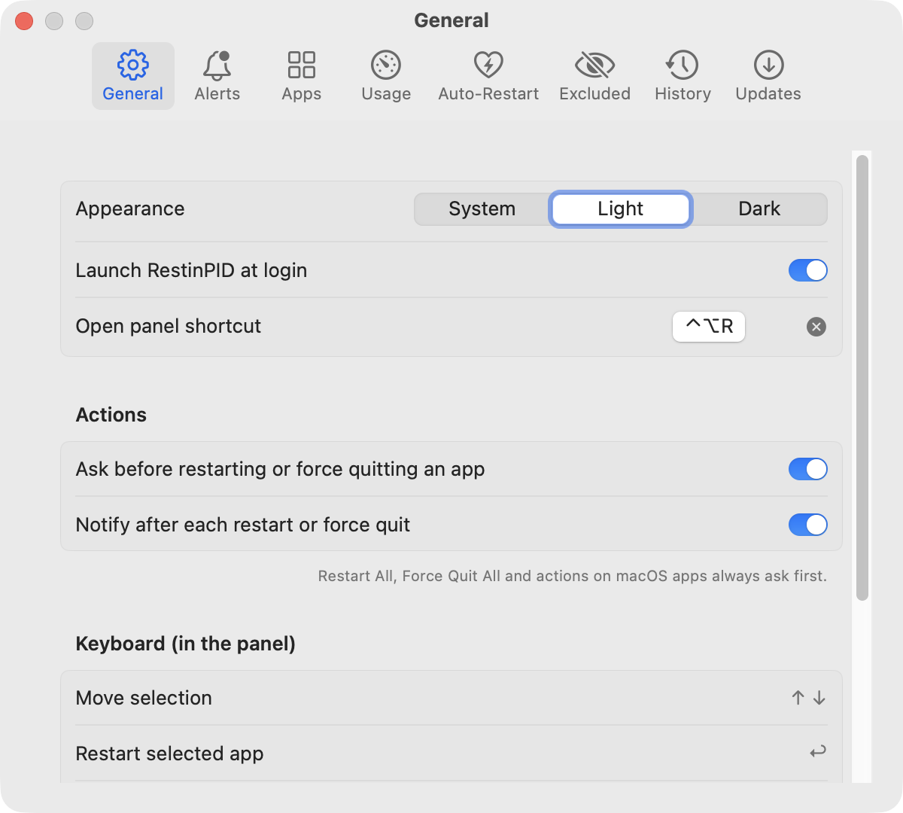

# RestinPID

*Rest in PID.* A menu bar app for your Mac that force quits and restarts apps, even frozen ones. It also shows how much RAM and CPU each app is using.

Free and open source. macOS 13 Ventura or later, Apple silicon and Intel. [Download the latest version](https://github.com/prabeshbhetwal/RestinPID/releases/latest).

<p>
  
</p>

## What it does

Click the RestinPID icon in the menu bar, or press **⌃⌥R**. A panel lists the apps that are running right now:

- **Apps:** the apps you use from the Dock.
- **Menu Bar & Background:** apps that run quietly in the menu bar or background, such as Paste, Raycast or KeepingYouAwake.
- **macOS:** apps that come with your Mac, such as Finder, Dock and Control Centre. They appear only when they use more RAM or CPU than your limit, or stop responding.
- **Needs Attention:** apps that aren't responding, and busy macOS apps, gathered in one group at the top. You can move it to the bottom in Settings → Apps.

Each app shows its **RAM** and **CPU** use: the same measures Activity Monitor uses, with each app's helper processes added in. A figure turns orange when it goes over your limit. A red **Not Responding** label marks frozen apps.

When an app stops responding, the menu bar tombstone turns into a solid red badge with a “!” and a count of frozen apps. A glow pulses behind it and it jiggles every few seconds until you open the panel (for up to 10 minutes), like a Dock icon asking for attention. The badge carries its own halo, so it stays visible on black, white and everything in between. Settings → Alerts sets the colour, icon size, glow speed, jiggle strength and timing, and has a preview button. With Reduce Motion on, the glow holds steady and nothing moves.




Click an app to restart it, or use its buttons:

- **Restart** quits the app, even a frozen one, and opens it again.
- **Force Quit** quits the app without reopening it.
- **Hide** (eye-slash) takes the app out of the list for a while, until it restarts, or for good.

Restarting or force quitting an app loses any unsaved work in it, so RestinPID asks first. You can turn that off in **Settings → General**. **Restart All** and **Force Quit All** act on every app in the list at once, except macOS apps. They always ask first.

Quitting an app owned by another user on your Mac needs your administrator password; macOS shows the prompt.

To restart RestinPID itself, click **⟳** next to the gear at the top of the panel.

## Features

- **Auto-restart frozen apps:** choose apps that restart by themselves when they stay frozen for a time you set. Installer, Disk Utility and Migration Assistant are never restarted automatically, because stopping them mid-job can do damage.
- **Restarts itself:** if RestinPID ever freezes or slows down, it restarts itself. You can turn this off.
- **Hide quiet apps:** show only apps that are busy, meaning over your RAM limit **or** CPU limit, or over **both** at once. You choose which.
- **Search and pins:** type to filter the list, and pin the apps you use most to the top. Pin a macOS app to always see it.
- **Quick hide:** the eye-slash button on a row hides that app for 15 minutes, 1 hour, 4 hours, until tomorrow, until the app restarts, or always. Temporary hides are listed in Settings → Excluded, with a Show button.
- **Exclude list:** hide apps you never want to see or touch.
- **History:** a log of every restart and force quit, automatic ones included.
- **Notifications:** an optional notice after each restart or force quit.
- **Keyboard control:** use the whole panel without a mouse.
- **Appearance:** Light, Dark, or follow your Mac.
- **Launch at login.**
- **Automatic updates,** on a schedule you choose.

## Install

1. Download the latest `RestinPID-<version>.zip` from [Releases](https://github.com/prabeshbhetwal/RestinPID/releases/latest).
2. Unzip it and drag **RestinPID** into your **Applications** folder.
3. Open RestinPID. RestinPID isn't notarised by Apple yet, so the first time macOS says it can't check it:
   - **macOS 15 Sequoia and later:** click **Done**, open **System Settings → Privacy & Security**, scroll down and click **Open Anyway** next to RestinPID, then confirm.
   - **macOS 13 and 14:** right-click RestinPID, choose **Open**, then **Open** again.

   macOS asks this only once.

**Allow Accessibility access** so RestinPID can tell when an app is not responding: go to **Settings → Auto-Restart → Open Accessibility Settings…** and switch RestinPID on. Without it, everything else still works, but there's no Not Responding badge and no auto-restart.

Works on macOS 13 Ventura and later, on Apple silicon and Intel Macs.

## Keyboard shortcuts

| Keys | In the panel |
|---|---|
| ⌃⌥R | Open or close the panel (you can change this) |
| ↑ ↓ | Move through the list |
| ↩ | Restart the selected app |
| ⌘↩ or ⌘⌫ | Force quit the selected app |
| ⌘P | Pin or unpin the selected app |
| Esc | Clear the search, then close |
| ⌘, | Open Settings |

**Right-click an app** to restart it, force quit it, pin it, auto-restart it when frozen, exclude it, or show it in Finder.

**Right-click the menu bar icon** for Settings, updates, feedback and Quit.

## Settings



| Tab | What you can change |
|---|---|
| General | Appearance, launch at login, the panel shortcut, whether to ask before each action (on unless you turn it off), and notifications. |
| Alerts | The Not Responding warning in the menu bar: colour, solid or outline, count, icon size, glow speed, jiggle strength and timing, and a preview. |
| Apps | Which apps the list shows: menu bar and background apps, only busy apps, and macOS apps. Also what "busy" means: RAM **or** CPU over your limits, or **both** at once. |
| Usage | RAM and CPU on each app, totals in the panel (per group or the whole Mac), and an optional reading next to the menu bar icon. |
| Auto-Restart | Apps that restart by themselves when frozen, how long to wait first, and whether RestinPID restarts itself if it gets stuck. |
| Excluded | Apps that never appear in the list. |
| History | Every restart and force quit. |
| Updates | How often to check (every day, week, two weeks, month, or never), and whether to install updates automatically. |

## Updates

RestinPID checks for new versions on the schedule you set in **Settings → Updates**. When one is ready:

- a dot appears on the menu bar icon,
- a banner appears at the top of the panel,
- and you get a notification.

Click any of them to see what's new and install it. To check right away, choose **Check for Updates…** from the gear menu.

## Privacy

RestinPID has no accounts, analytics or crash reporting. Everything it measures (apps, RAM, CPU, history and settings) stays on your Mac.

It goes online only to check for and download updates, using [Sparkle](https://sparkle-project.org). The check fetches a file from GitHub (`raw.githubusercontent.com`) and updates download from GitHub Releases. Like any web request, GitHub sees your IP address, and the request names the RestinPID and macOS versions. RestinPID doesn't send a system profile. You can turn off automatic checks in **Settings → Updates**. GitHub's own [privacy statement](https://docs.github.com/en/site-policy/privacy-policies/github-general-privacy-statement) covers what it keeps.

**Send Feedback…** opens a GitHub issue page in your browser, filled in with what you typed and, if you leave it ticked, your RestinPID version, macOS version and chip. Nothing is sent until you submit it there, and GitHub issues are public, along with your GitHub username.

Questions about privacy: open an issue, or use [private security reporting](https://github.com/prabeshbhetwal/RestinPID/security/advisories/new) for anything you don't want public.

## Licence

RestinPID is free and open source under the [MIT licence](LICENSE). It comes as is, with no warranty, to the extent the law allows. It includes [Sparkle](https://github.com/sparkle-project/Sparkle) (MIT licence; its notice ships inside the app as `Sparkle-LICENSE.txt`).

## Feedback

Found a problem or have an idea? Choose **Send Feedback…** from the gear menu, or [open an issue](https://github.com/prabeshbhetwal/RestinPID/issues/new/choose). Issues are public, so leave out names, emails and file paths.

## Build from source

Needs Xcode 15 or later (Swift 5.9). See [DEVELOPING.md](DEVELOPING.md) for the self-test and the release steps.

```sh
git clone https://github.com/prabeshbhetwal/RestinPID.git
cd RestinPID
./build.sh && open RestinPID.app
```

## Coming from AppRestarter?

RestinPID is the new name for AppRestarter. To switch:

1. Install RestinPID as above.
2. Quit AppRestarter and delete it.
3. Allow Accessibility access once more, for RestinPID.

Your settings and history carry over automatically.
