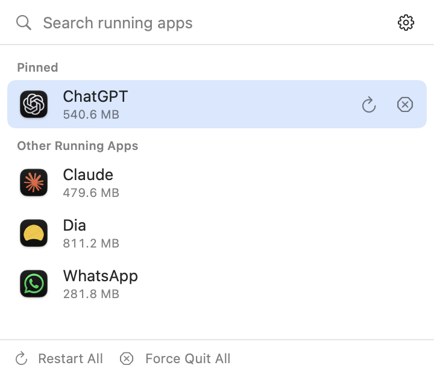
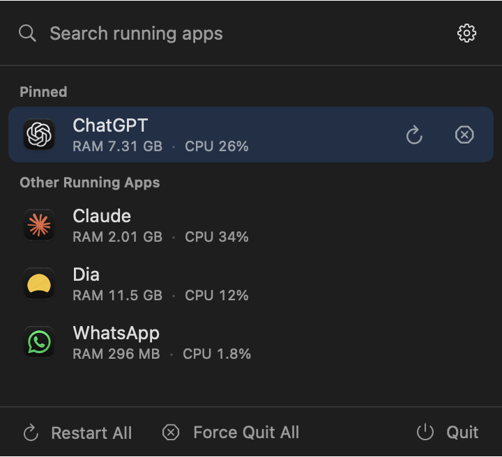
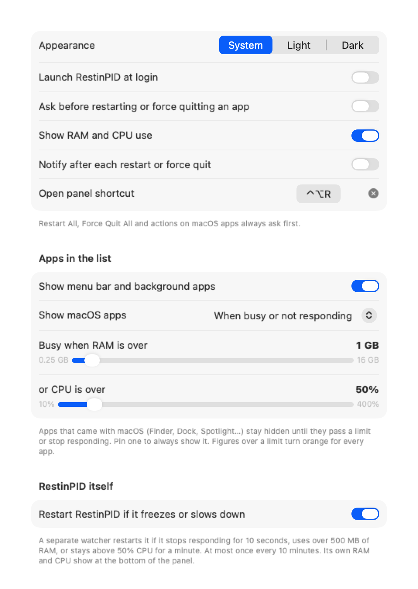
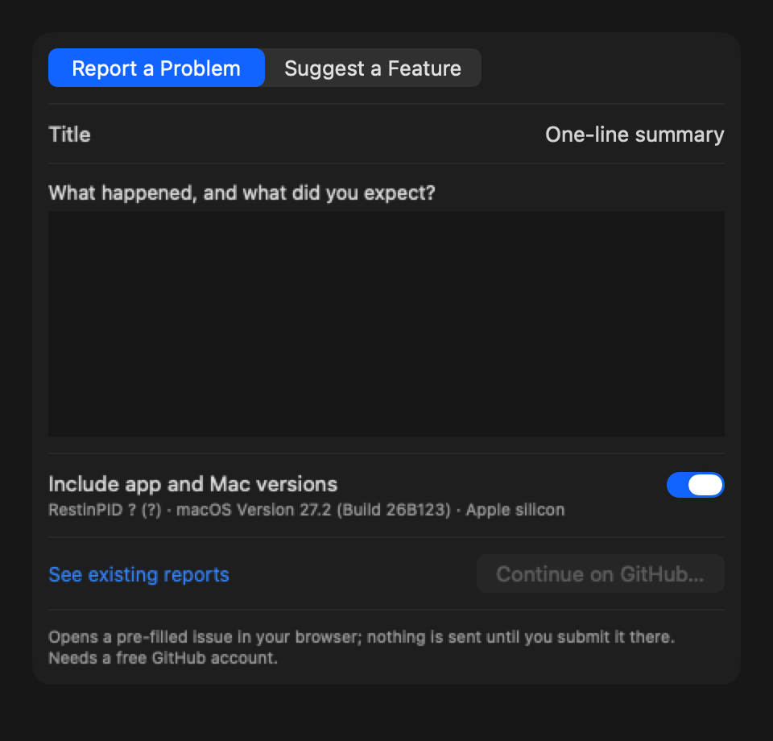

# RestinPID

*Rest in PID.* A menu bar app for your Mac that force quits and restarts apps, even frozen ones. It also shows how much RAM and CPU each app is using.

  
  

## What it does

Click the RestinPID icon in the menu bar, or press **⌃⌥R**. A panel lists the apps that are running right now:

- **Apps:** the apps you use from the Dock.
- **Menu Bar & Background:** apps that run quietly in the menu bar or background, such as Paste, Raycast or KeepingYouAwake.
- **macOS:** apps that come with your Mac, such as Finder, Dock and Control Centre. They appear only when they use more RAM or CPU than your limit, or stop responding.
- **Needs Attention:** apps that aren't responding, and busy macOS apps, gathered in one group at the top. You can move it to the bottom in Settings → Apps.

Each app shows its **RAM** and **CPU** use, measured the way Activity Monitor measures them, helper processes included. A figure turns orange when it goes over your limit. A red **Not Responding** badge marks frozen apps.

Click an app to restart it, or use its two buttons:

- **Restart** quits the app, even a frozen one, and opens it again.
- **Force Quit** quits the app without reopening it.

**Restart All** and **Force Quit All** act on every app in the list at once, except macOS apps. They always ask first.

To restart RestinPID itself, click **⟳** next to the gear at the top of the panel.

## Features

- **Auto-restart frozen apps:** choose apps that restart by themselves when they stay frozen for a time you set.
- **Restarts itself:** if RestinPID ever freezes or slows down, it restarts itself. You can turn this off.
- **Hide quiet apps:** show only apps that are busy, meaning over your RAM limit **or** CPU limit, or over **both** at once. You choose which.
- **Search and pins:** type to filter the list, and pin the apps you use most to the top. Pin a macOS app to always see it.
- **Exclude list:** hide apps you never want to see or touch.
- **History:** a log of every restart and force quit, automatic ones included.
- **Notifications:** an optional notice after each restart or force quit.
- **Keyboard control:** use the whole panel without a mouse.
- **Appearance:** Light, Dark, or follow your Mac.
- **Launch at login.**
- **Automatic updates,** on a schedule you choose.

## Install

1. Download the latest `RestinPID-<version>.zip` from [Releases](https://github.com/prabeshbhetwal/RestinPID/releases/latest).
2. Unzip it and drag **RestinPID** into your **Applications** folder.
3. The first time, **right-click** RestinPID and choose **Open**, then **Open** again. macOS asks this once for apps downloaded outside the App Store.

**Allow Accessibility access** so RestinPID can tell when an app is not responding: go to **Settings → Auto-Restart → Open Accessibility Settings…** and switch RestinPID on. Without it, everything else still works, but there's no Not Responding badge and no auto-restart.

Works on macOS 13 Ventura and later, on Apple silicon and Intel Macs.

## Keyboard shortcuts

| Keys | In the panel |
|---|---|
| ⌃⌥R | Open or close the panel (you can change this) |
| ↑ ↓ | Move through the list |
| ↩ | Restart the selected app |
| ⌘↩ or ⌘⌫ | Force quit the selected app |
| ⌘P | Pin or unpin the selected app |
| Esc | Clear the search, then close |
| ⌘, | Open Settings |

**Right-click an app** to restart it, force quit it, pin it, auto-restart it when frozen, exclude it, or show it in Finder.

**Right-click the menu bar icon** for Settings, updates, feedback and Quit.

## Settings

| Tab | What you can change |
|---|---|
| General | Appearance, launch at login, the panel shortcut, whether to ask before each action, and notifications. |
| Apps | Which apps the list shows: menu bar and background apps, only busy apps, and macOS apps. Also what "busy" means: RAM **or** CPU over your limits, or **both** at once. |
| Usage | RAM and CPU on each app, totals in the panel (per group or the whole Mac), and an optional reading next to the menu bar icon. |
| Auto-Restart | Apps that restart by themselves when frozen, how long to wait first, and whether RestinPID restarts itself if it gets stuck. |
| Excluded | Apps that never appear in the list. |
| History | Every restart and force quit. |
| Updates | How often to check (every day, week, two weeks, month, or never), and whether to install updates automatically. |

## Updates

RestinPID checks for new versions on the schedule you set in **Settings → Updates**. When one is ready:

- a dot appears on the menu bar icon,
- a banner appears at the top of the panel,
- and you get a notification.

Click any of them to see what's new and install it. To check right away, choose **Check for Updates…** from the gear menu.

## Privacy

Everything RestinPID measures stays on your Mac. It only goes online to check for updates. Feedback opens a page in your browser, and nothing is sent until you submit it there.

## Feedback

Found a problem or have an idea? Choose **Send Feedback…** from the gear menu, or [open an issue](https://github.com/prabeshbhetwal/RestinPID/issues/new/choose).

## Coming from AppRestarter?

RestinPID is the new name for AppRestarter. To switch:

1. Install RestinPID as above.
2. Quit AppRestarter and delete it.
3. Allow Accessibility access once more, for RestinPID.

Your settings and history carry over automatically.
